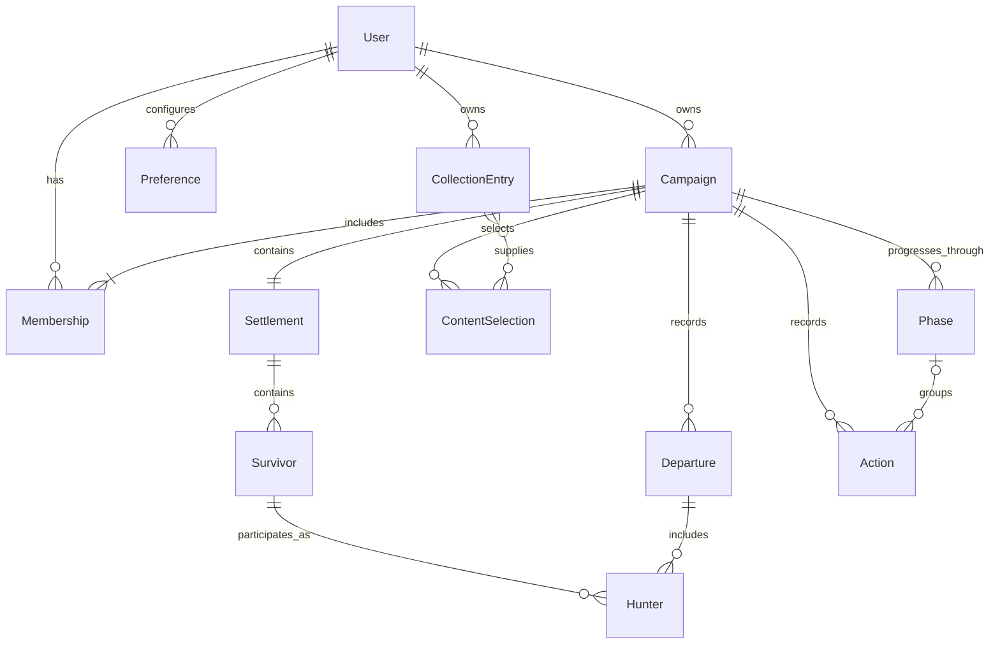
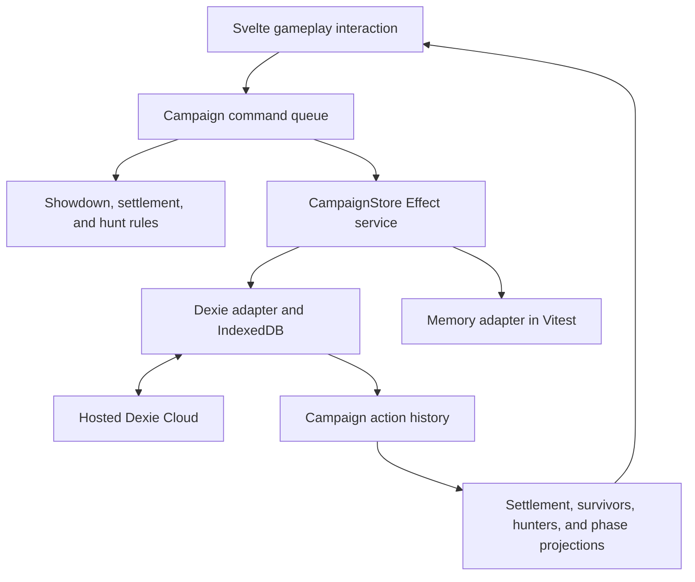
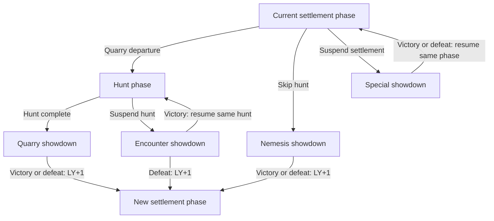

# KDM campaign and synchronization design

Status: proposed design only. These campaign services, domain records, synchronization flows, and gameplay history are not implemented. Use [the collection architecture](kdm-architecture.md) for implemented behavior.

## Scope and proposed records

The proposed app supports guest use and offline saves, with optional account sync across devices and campaign sharing. Collection tracking, campaign management, and preferences use current records; planned gameplay uses an action history.

| Area                | Data                                                                | Gameplay undo           |
| ------------------- | ------------------------------------------------------------------- | ----------------------- |
| Collection          | Owned content, editions, wishlist, and related details              | None                    |
| Campaign management | Setup, names, ongoing or archived status, ownership, and membership | None                    |
| Campaign gameplay   | Settlement, survivors, hunters, progress, and phase state           | Every game-state change |
| Preferences         | Account and device settings                                         | None                    |
| Catalog             | Bundled, versioned reference data                                   | None                    |

## Domain relationships



Gameplay entities may be history projections rather than separate synchronized tables.

- Each campaign has exactly one owner, who is also a member, and exactly one settlement.
- Users can belong to many campaigns; campaigns can have many members.
- Each ContentSelection belongs to one campaign and identifies gameplay covered by a user's collection, with references to its supplying acquisitions.
- A settlement belongs to one campaign and contains its survivors, including historical survivors.
- A survivor belongs to one settlement. Player control of a survivor does not confer record or campaign ownership.
- Each Hunter references one settlement survivor and one departure in the same campaign. A departure has at most one Hunter per survivor.
- Every phase and gameplay action belongs to one campaign. All references must stay within that campaign.
- Phase occurrences have stable IDs. An interrupted phase keeps its ID and progress when resumed.
- Initialization and campaign-wide actions may have no phase reference.

Derive campaign and survivor lists from memberships and references. The settlement projection can use `campaignId` as its key.
The persistence adapter must enforce relationships; IndexedDB does not enforce foreign keys.

## Hunters and departures

A Hunter records a survivor's participation in a departure through `survivorId` and `departureId`.
Hunt and showdown rosters contain Hunters; the settlement retains all survivors.

| State                                                                 | Owner               |
| --------------------------------------------------------------------- | ------------------- |
| Survivor identity, permanent attributes, and lasting changes          | Settlement survivor |
| Armor points, temporary gear bonuses, and hunt/showdown display order | Hunter              |
| Monster state and hunt progress                                       | Phase occurrence    |

Read permanent survivor information through the reference. Derive bonuses from gear and recorded modifiers where possible. Hunter
gameplay changes use campaign commands; lasting outcomes update the survivor explicitly rather than copying all Hunter fields back.

The departure defines the Hunter lifecycle:

1. Create Hunters for selected survivors during departure preparation in settlement.
2. Keep their IDs through hunt, encounter showdowns, and the quarry showdown. Nemesis and special showdowns can create a departure without a hunt.
3. Keep returning Hunters through settlement return processing; apply return-specific lasting outcomes once.
4. Close the departure and remove its Hunters from active state. A later departure creates fresh Hunters without carrying over temporary values.

Define field initialization and reset rules for hunt entry, showdown entry, resumption, and return. Fields may reset before the
departure ends. Preparation and return processing can show Hunters alongside survivors, including after a special showdown.

Persist and synchronize active Hunters through campaign history. Closing a departure retains rewind history and excludes temporary
values from later gameplay.

## Ownership, membership, and campaign lists

Store one campaign owner identity. Memberships associate users, campaigns, and permissions; pending invitations are inactive.
Derive campaign lists, including owned campaigns, from memberships and status.

Archiving preserves settlement data, survivors, history, and memberships. Personal hiding or pinning belongs in user preferences.

Proposed management policy: the owner controls invitations, permissions, archive/restore, and ownership transfer. Archived campaigns
remain visible and read-only until restored. Transfers must preserve one owner and consistent access; an owner cannot leave a campaign
ownerless. These management policies remain open decisions.

The owner can delegate gameplay control without transferring ownership. Membership changes and management operations are outside
gameplay undo. Rewind must never restore an old access grant.

## Collection, campaign content, and preferences

Campaign setup offers gameplay covered by the user's collection, including coverage through inclusions, equivalences, and upgrade recipes.
Owning Core 1.5 plus Legendary Card Pack I qualifies the covered 1.6 gameplay and rules for selection without recording ownership of the Core 1.6 box.
Store choices as ContentSelection records with campaign, source user, source collection-entry references, selected content ID, edition ID,
and rules version. Coverage can depend on several acquisitions; one collection entry can supply multiple campaigns.

The campaign records its own rules version and selected content. A campaign marked 1.6 stays on 1.6 regardless of later collection edits,
removals, or lost coverage; collection changes do not invalidate campaign selections or require a coverage warning. Source references
record selection provenance rather than an ongoing eligibility requirement. Selections also survive membership changes.
Define a policy before allowing other members' content. Sharing exposes campaign selections without exposing personal collections.

Setup remains editable before play. Starting play records the selected rules and initial settlement and survivors as a versioned
baseline. Later gameplay-affecting content changes require validation and history entries, even if initiated in the campaign manager.
Replay uses the recorded rules version.

Account preferences can synchronize privately; device settings stay local. Collection and preference sync is optional and independent
of campaign sync. Neither requires action history or a collaborative real-time UI.

## Components and data flow

Collection persistence uses Dexie and IndexedDB. Proposed campaigns use hosted Dexie Cloud, Effect v4 workflows, and Svelte UI.
The browser connects directly to Dexie Cloud without a custom backend.



| Service             | Responsibility                                             |
| ------------------- | ---------------------------------------------------------- |
| `CollectionStore`   | Personal collection persistence                            |
| `PreferencesStore`  | Account and device preferences                             |
| Campaign management | Creation, listing, setup, metadata, status, and membership |
| `CampaignStore`     | Read gameplay history and atomically commit actions        |
| Campaign commands   | Serialize local commands and invoke phase rules            |
| Auth and sync       | Identity, access changes, and cloud status                 |

Services may share a Dexie connection. Adapter transactions span management and gameplay: creation atomically establishes metadata,
owner membership, and one settlement baseline; starting play atomically records setup and initial history.

Use separate access scopes for private and campaign data. Local-only data can use a separate database or unsynced tables. Keep the
catalog bundled.

## Campaign phases and shared state

Showdowns share a data model, commands, features, and undo. Record context separately from monster identity, with one outcome:
survivor victory or defeat.

| Showdown context   | Entry                | Victory                      | Defeat                       | Lantern-year change    |
| ------------------ | -------------------- | ---------------------------- | ---------------------------- | ---------------------- |
| Normal quarry      | After hunt           | New settlement phase         | New settlement phase         | +1                     |
| Normal nemesis     | Skip hunt            | New settlement phase         | New settlement phase         | +1                     |
| Hunt encounter     | Interrupt hunt       | Resume same hunt             | New settlement phase         | Victory: 0; defeat: +1 |
| Settlement special | Interrupt settlement | Resume same settlement phase | Resume same settlement phase | 0                      |



Campaign state holds the settlement, survivors, resources, equipment, and lantern year. Hunters hold departure state;
phase occurrences hold monsters and hunt progress. New settlement phases reuse the settlement; phases can share a year.

Persist the active phase, phase lifecycle states, and interrupting showdown's parent/return phase ID. Suspend the parent during the
showdown. On return, resume its saved progress with shared-state changes applied. Encounter defeat closes the hunt instead. Suspended
phases cannot advance. These states must survive reloads and sync.

Resolve each showdown in one atomic command that records its outcome, consequences, phase changes, and any year advancement. Resuming
a phase must not repeat its start effects. Duplicate resolution requests must not repeat consequences or advance the year twice.
Conflicting outcomes from different devices require reconciliation.

Navigation only changes the view. The persisted active phase controls gameplay, and the campaign queue survives phase navigation.

## Commands, events, and projected state

Commands describe intent; accepted events record changes. Serializable commands include stable ID, campaign ID, optional phase ID,
actor, schema version, payload, and dependencies. Each accepted command creates exactly one action containing all of its events;
the action commits atomically and forms one undo step. Events reference their command and action.
Resolving a showdown groups rewards, phase transitions, and lantern-year advancement in that same action.

Create IDs and random outcomes once per command. Retries reuse IDs; history replay reuses recorded rolls and draws.
Performing an undone action again creates a new command with a new ID and new random outcomes where applicable.

Keep game rules in ordinary pure functions:

- `decide(state, command)` validates the command and returns events or a domain failure.
- `project(history)` derives gameplay state from the baseline, events, and undo entries.

All edits to replayed state pass through commands, regardless of their screen. Display names, memberships, and preferences use current
records. Receiving remote events updates the projection without rerunning commands or external effects. Validate persisted records
with versioned schemas and report unsupported versions explicitly.

If replay needs optimization, add rebuildable checkpoints keyed by history and projection version. Include active Hunters,
departure and phase lifecycle, return references, outcomes, and lantern year. Invalidate affected checkpoints after earlier edits;
retain enough history for the promised rewind depth.

## Undo and rewind

Gameplay undo spans showdown, settlement, and hunt. Group drags and confirmed edits into useful steps; exclude view state,
authentication, and management.

Undo is sequential across the campaign's shared gameplay timeline. Only the latest active action can be undone, regardless of its
actor or phase; earlier actions cannot be selected while later actions remain active. Repeated undo walks backward one action at a time.
Append undo entries while preserving the original events. There is no redo operation or redo stack; users can perform an undone
action again through the normal gameplay controls as a new action.

If Nick adds a wound and Sam then adds another, Sam's action must be undone before Nick's. If a showdown awards resources later spent
on crafting, undo crafting and every other later action before undoing the showdown reward. There is no selective or cascading undo.

| Action                                | Undo behavior                                                      |
| ------------------------------------- | ------------------------------------------------------------------ |
| Counter change                        | Restore the value before the latest action                         |
| Position, equipment, or status change | Restore the state before the latest action                         |
| Resource spending or survivor changes | Reverse the latest action's grouped effects                        |
| Phase resolution                      | Reverse consequences, phase changes, and year advancement together |
| Random result                         | Undo its effects; repeating the action generates a new result      |

Rewind means repeated sequential undo, including across phase boundaries. Any active campaign member can undo the latest action,
including another member's action; ownership, controller status, and survivor assignment do not restrict undo. Pending invitations
and former members grant no access. Archived campaigns remain read-only. Navigation does not select an undo target, and no member
can skip a later action.

Rewinding encounter defeat restores the hunt and reverses the new settlement phase and year advancement. Rewinding interruption or
resumption restores phase lifecycle and progress. Dependencies can cross phase IDs, including actions before an interrupted showdown.
Completing a phase preserves its history.

Rewind must also restore Hunter creation, temporary fields, and departure lifecycle. Reversing return processing must address lasting
survivor changes and restore the returning Hunters together.

Concurrent undo requests must reverse the same latest action at most once. Reject stale targets if the timeline has advanced;
a retry must not silently undo a different action. Undo references the exact action being reversed. A delayed undo must not affect
a new action performed after an earlier undo. The representation, conflict policy, and rewind depth remain open decisions.

## Effect services and persistence contract

Define `CampaignStore` as a small `Context.Service` with Effect-returning methods and Dexie and memory implementations.
Phase commands share its contract and queue, with separate rules.

| Operation          | Contract                                                                 |
| ------------------ | ------------------------------------------------------------------------ |
| `read(campaignId)` | Return validated history, relevant inputs, and a local version token     |
| `commit(change)`   | Check the token and atomically persist events and a deduplication record |

Both implementations must:

1. Return success for an identical committed command without applying it again, before checking its stale token.
2. Reject an ID reused with different content.
3. Return a typed stale-input failure when relevant inputs changed.
4. Commit every event together or none.
5. Enforce campaign references and phase invariants.
6. Report local persistence success independently of cloud acceptance.

The token detects other-tab writes, incoming sync, reconciliation removals, and management changes affecting command validity. Its
implementation is unresolved. A process-local counter cannot cover these changes, and the token provides no distributed lock.

```text
campaign queue -> read -> project -> decide -> atomic commit -> publish
```

Use one semaphore per active campaign to serialize preparation and commit; add an Effect Queue only for inspection or backpressure.
Only committed history is durable. The collection queue still serializes persistence only.

Bound retries and preserve intent and random results. Cancellation after a successful commit requires an undo to reverse gameplay.
Settle an in-flight write before releasing the queue. Dexie Cloud owns network retries.

Use named `Effect.fn` operations, feature-owned `Schema.TaggedError` failures, and `Layer.effect` implementations. The Dexie adapter
owns transactions and translates SDK failures. Keep unrelated asynchronous work outside
[IndexedDB transactions](<https://dexie.org/docs/Dexie/Dexie.transaction()>).

Reuse a `ManagedRuntime` for the application or campaign session; dispose it when its owner ends. Auth and sync status are separate
services, so game commands and memory tests need no login or connection.

## Sharing and synchronization

Use one realm per shared campaign for setup and gameplay. Map membership to Dexie Cloud member records and the campaign owner to realm
ownership. Include the owner as a member for sync access. Keep collections and account preferences private.

Cloud `realmId` controls visibility; reserved `owner` metadata grants record privileges. Configure these independently of actor
attribution so appending an action does not grant unintended management rights. A domain `ownerId` alone grants no cloud authority.
See [Dexie Cloud access control](https://dexie.org/docs/cloud/access-control).

Dexie Cloud supplies authentication and real-time WebSocket updates. All phases synchronize within the campaign. Local commits work
offline and sync when connected. No application WebSocket server is needed. See
[configuration](<https://dexie.org/docs/cloud/db.cloud.configure()>).

Dexie Cloud preserves transaction atomicity during sync. Custom client rules and the local queue do not provide global command
validation or ordering. See [consistency guarantees](https://dexie.org/docs/cloud/consistency).

Proposed cooperation policy: players control assigned survivors, and a designated controller advances shared actions and phases.
The controller need not own the campaign. Define reconciliation for handoffs, late offline edits, and conflicting outcomes or
transitions. Timestamp order alone does not establish causality or game validity. Strict server enforcement would require an
authoritative command processor.

Display local save and cloud status separately. Permission changes can reject saved actions during sync. Rebuild from reconciled history
and identify affected actions; application history is immutable, but the sync layer can remove rejected records.

## Guest adoption and offline UI

Guests use a stable local identity. Account adoption preserves entity and command IDs, maps ownership to the account, and retains
historical actor attribution. Shared membership requires authentication. Actor labels never authorize writes.

Define upload opt-in and handling of unsynced work during logout/account changes. Dexie Cloud can attach guest data on login; selective
upload requires separate local drafts until chosen. Campaign login must not silently upload unrelated personal data.

Svelte observes local history and metadata through adapter subscriptions, such as `liveQuery`. Release subscriptions with their owner.
UI callbacks run commands and report typed failures without treating interruption as failure. Keep any optimistic overlay separate
from committed history; remove only the failed action's overlay.

The SvelteKit service worker caches app assets; IndexedDB stores campaign data. Offline use requires cached assets and local data.
Review existing registration before adding Dexie Cloud worker behavior.

## Tests and implementation sequence

Use Vitest and version-aligned `@effect/vitest`.
Dexie tests cover transactions and stale revisions; optimistic store tests cover patches and rollback. Client tests live under `test/client/`.
Campaign memory layers should allocate fresh state in `Layer.effect`, use atomic `Ref` updates, and match the Dexie contract without
browser, IndexedDB, Dexie imports, credentials, or network.

Current collection tests also cover monitoring failures, retry readiness, changes during refresh, and owner changes during workbook operations. Action tests cover typed failures, mixed causes, defects, and cancellation; transfer tests cover validated backups and workbook representation limits. Keep this coverage when simplifying Effect workflows.

| Test layer                                           | Coverage                                                                                                                                                                    |
| ---------------------------------------------------- | --------------------------------------------------------------------------------------------------------------------------------------------------------------------------- |
| Pure rules and commands with memory services         | Relationships, content stability, phase routes, sequential undo, random replay, deduplication, stale inputs, malformed versions, failures, cancellation, and conflict rules |
| Shared memory/Dexie contract suite and browser tests | Adapter guarantees, transactions, reloads, checkpoints, and competing tabs                                                                                                  |
| Cloud integration                                    | Two devices, offline reconnects, sharing permissions, guest adoption, and rejected writes                                                                                   |

Test every transition in the phase table, including year advancement exactly once and parent progress on resume. Rewind must restore
outcomes, phase lifecycle, and year consistently. Also test campaign isolation, membership-based lists, and management/preferences
remaining outside undo. Verify that earlier actions cannot be undone while later actions remain active, including actions by another
player or in another phase. Verify that any active member can undo another member's latest action, while pending invitees and former
members cannot undo and archived campaigns remain read-only. Use `Deferred` for concurrency and `TestClock` for time; control failures through test services.

Test Hunter references, field resets, stable IDs through interrupted hunts, return processing, and fresh state on later departures.
Reload and sync must preserve active Hunters; rewind must restore them after departure closure.

Implementation order:

1. Define versioned models, phase rules, dependencies, and undo semantics.
2. Build pure rules, memory services, and transition/rewind tests.
3. Add campaign Dexie adapters and verify creation, persistence, reloads, and concurrency.
4. Connect campaign management and phase UIs to services and history controls.
5. Add optional auth and sync after defining adoption, permissions, and reconciliation.

Validate two devices with normal year advancement, settlement crafting and rewind, hunt victory/resumption, hunt defeat, and settlement
interruption/resumption. Include offline edits and a rejected write. Preference sync can proceed independently of campaign work.

## Open decisions

- Physical schema and local version token.
- Undo conflict representation and rewind depth.
- Controller handoff, event ordering, and offline reconciliation.
- Management permissions, archive behavior, and ownership transfer.
- Guest adoption, upload opt-in, and unsynced work during account changes.
- Hunter field initialization/reset rules, return processing, and shared versus per-user display order.
